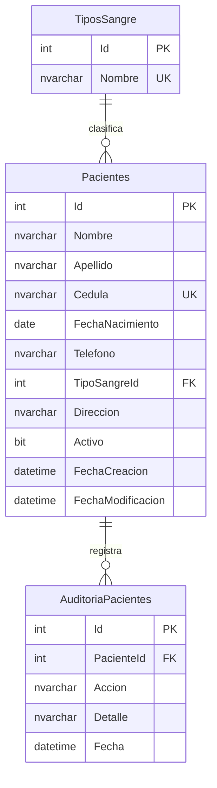

# Registro de Pacientes - POO + Base de datos (SQL Server)

Aplicación de consola en C# (.NET 8) con POO conectada a **SQL Server** usando ADO.NET (`Microsoft.Data.SqlClient`).

**Autor:** Emil Gómez Rodríguez - 2026-0935

## Modelo de datos

- **Borrado lógico:** eliminar un paciente pone `Activo = 0`; no se pierde el historial.
- **Restricciones:** cédula `UNIQUE`, `CHECK` de longitud, llaves foráneas, `DEFAULT GETDATE()` en fechas.
- **Índices:** apellido/nombre, tipo de sangre y paciente en la auditoría.

## Cómo ejecutar
1. Abrir **SQL Server Management Studio** y ejecutar `ModeloDatos.sql` (crea la base `RegistroPacientesDB`, las tablas y datos de ejemplo).
2. Revisar la cadena de conexión en `ConexionBD.cs` (por defecto `.\SQLEXPRESS` con autenticación de Windows).
3. Abrir `TareaBaseDeDatos.csproj` en Visual Studio. El paquete `Microsoft.Data.SqlClient` se instala solo; si no, usar **Proyecto > Administrar paquetes NuGet**.
4. Presionar **F5**.

## Estructura
| Archivo | Función |
|---|---|
| `ModeloDatos.sql` | Script del modelo de datos |
| `ConexionBD.cs` | Cadena de conexión |
| `PacienteRepositorio.cs` | Acceso a datos con consultas **parametrizadas** (evita inyección SQL) |
| `GestorPacientes.cs` | Lógica del sistema |
| `Paciente.cs`, `Entrada.cs` | Modelo y validación de entradas |
| `Program.cs` | Menú principal; manejo de errores de base de datos y no se cierra hasta elegir Salir |
